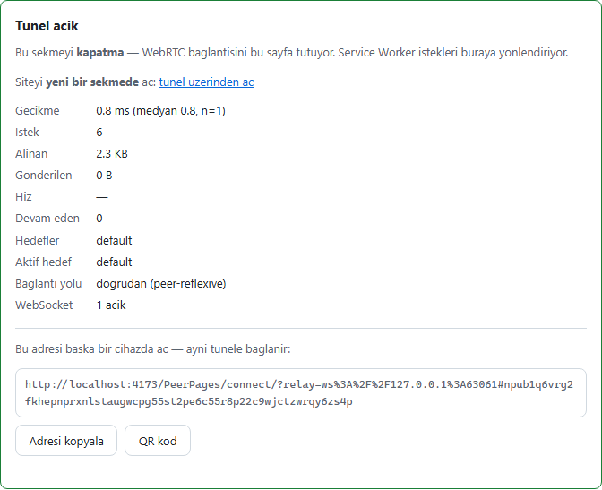
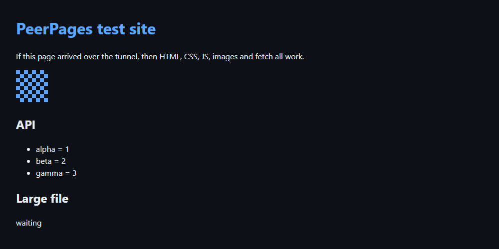

# PeerPages

**Share your localhost over GitHub Pages. No server in between.**

A visitor opens `https://aliosmanmho.github.io/PeerPages/#<your-peer-id>`. That
page installs a Service Worker, opens a WebRTC data channel to the agent running
on your machine, and your `localhost:3000` renders in their browser — relative
links, CSS, JS, images, `fetch`, downloads, SSE and WebSockets included.

There is no proxy server, no relay you have to trust, and no account. The static
page sits on GitHub Pages, signaling goes through public [Nostr](https://nostr.com)
relays as end-to-end encrypted ephemeral events, and the traffic itself is a
direct DTLS-encrypted WebRTC connection between the two browsers' machines. The
agent is a single Go binary.

| What you see | What your visitor sees |
|---|---|
|  |  |

<sub>Real screenshots, generated by `web/e2e/demo.spec.ts` against a working
tunnel — not mock-ups. The interface is currently Turkish; see
[Honest limits](#honest-limits).</sub>

> **What this is for:** showing work in progress to a colleague or a client,
> getting a mobile device onto your dev server, demoing a branch. It is a
> sharing tool, not a hosting product — see [Honest limits](#honest-limits).

## Quickstart

You need [Go 1.27+](https://go.dev/dl/) for now; prebuilt binaries land with the
first tagged release.

```bash
go install github.com/aliosmanmho/PeerPages/agent/cmd/peerpages@latest
```

Start whatever you already run locally (`npm run dev`, `python -m http.server`,
a Rails app — anything that speaks HTTP), then point the agent at it:

```bash
peerpages serve --target http://localhost:3000
```

The agent prints your **peer-id** and the exact URL to share. Send that URL to
anyone; they open it in a normal browser and your site is there. Keep the
terminal open — the tunnel lives as long as the agent runs.

<details>
<summary>Build from source instead</summary>

```bash
git clone https://github.com/aliosmanmho/PeerPages.git
cd PeerPages/agent
go build -o peerpages .
./peerpages serve --target http://localhost:3000
```

</details>

Useful extras:

```bash
peerpages serve -t http://localhost:3000 --secret my-shared-word  # require a secret
peerpages serve -t http://localhost:3000 -t admin=http://localhost:4000  # two targets
peerpages serve -t http://localhost:5173 --inject-ws-shim  # WebSocket / Vite HMR
peerpages doctor   # check relays, NAT type and (optionally) TURN
peerpages key      # show your peer-id and visitor URL again
```

## Why not ngrok?

|  | ngrok / Cloudflare Tunnel | web-p2p-tunnel (2024) | **PeerPages** |
|---|---|---|---|
| Relay server | yes (third party) | no | **no** |
| Signaling server | — | yes (its own WebSocket server) | **no** (Nostr) |
| Account / signup | required | not required | **not required** |
| Visitor installs anything | no | no | **no** |
| Who can see your traffic | the provider | nobody | **nobody** |
| Price | limited free tier | free | **free** |

The difference that matters: with a tunnel provider, your traffic is decrypted
and re-encrypted on their machine because they terminate TLS. Here the bytes go
from your machine to the visitor's machine, and the only thing a third party
(the Nostr relay) sees is *"some public key received an encrypted blob"*.

## How it works

```
 visitor's browser                                    your machine
┌────────────────────────────────┐              ┌──────────────────────────┐
│ …github.io/PeerPages/#abc123   │              │ peerpages agent (Go)     │
│  ├─ app shell (Vite + TS)      │  WebRTC data │  ├─ Nostr signaling      │
│  ├─ Service Worker ──fetch──►  │◄════════════►│  ├─ pion/webrtc          │
│  └─ RTCPeerConnection          │  (DTLS, E2E) │  └─ reverse proxy ──────►│ localhost:3000
└───────────────┬────────────────┘              └────────────┬─────────────┘
                │  offer / answer / ICE, NIP-44 encrypted,   │
                │  ephemeral events (nothing is stored)      │
                └──────────────► Nostr relays (wss://…) ◄────┘
```

1. **The page** is a ~46 KB (gzipped) static app on GitHub Pages. Nothing about it is
   per-user; your peer-id travels in the URL fragment, which browsers never
   send to the server.
2. **Signaling** is four public Nostr relays (`nos.lol`, `relay.primal.net`,
   `nostr.mom`, `relay.damus.io`). The offer/answer exchange is encrypted with
   NIP-44 and published as *ephemeral* events, which relays are not supposed to
   store. You can point the agent at your own relays with `--relay`.
3. **The Service Worker** intercepts every request inside its own scope and
   forwards it over the data channel, streaming the response back. That is why
   a tunneled site behaves like a normal site instead of an iframe preview.
4. **The agent** is a reverse proxy to the targets you named on the command
   line — and only those.

Details: [`protocol/README.md`](protocol/README.md) is the normative wire
format, verified by shared test vectors in both the TypeScript and the Go
implementation.

## Security model

Six rules the project holds itself to (same numbering as
[`docs/BRIEF.md`](docs/BRIEF.md) §6):

1. **The agent never requests a host you did not pass on the CLI.** Deriving a
   host from the request path is impossible by construction, not by filtering.
2. **Signaling content is always encrypted.** Relays only learn that a public
   key received something.
3. **The peer-id is a full 32-byte public key**, and `--secret` adds a second
   layer that rejects visitors who do not know the word.
4. **The visitor is untrusted.** Path and header validation, body ceiling
   (`--max-body`, 50 MB), concurrency and stream ceilings, replay and
   clock-skew rejection on signaling.
5. **The Service Worker only touches its own scope** — never other origins.
6. **Logs mask URL paths by default** (`/api/items` → `/*3/*5`); `--verbose`
   turns masking off.

The full threat model — what an observer of the relays sees, what guessing a
peer-id would take, what a malicious visitor can and cannot do, and the
trade-offs we knowingly accepted — is in **[`docs/SECURITY.md`](docs/SECURITY.md)**.

## Honest limits

These are real and measured, not hypothetical:

- **The agent must stay running.** Close the terminal and the tunnel is gone.
  There is no supervisor that restarts it.
- **The tunnel-owner tab must stay open.** WebRTC lives in the page, not in the
  Service Worker; if that tab closes, visitors get the connect screen back.
- **One active tunnel per origin.** Multiple projects are selected with
  `#peer-id/target`, but one browser origin serves one agent at a time.
- **Root-absolute paths break on a project page.** On
  `user.github.io/PeerPages/`, a site asking for `/style.css` escapes the
  Service Worker's scope and 404s. A custom domain (or a user page at the
  domain root) removes this limit entirely.
- **Search engines never see the content.** No SEO, by design.
- **Some networks need a TURN server.** If both sides are behind symmetric NAT,
  a direct connection cannot be established; `peerpages doctor` tells you in
  advance and [`docs/TURN.md`](docs/TURN.md) explains the (optional) fallback.
  TURN is the single exception to "no server in between" and is off by default.
- **Only Chromium is verified.** The end-to-end suite runs on Chromium; Firefox
  and Safari are expected to work but have not been measured.
- **WebSocket support is opt-in** (`--inject-ws-shim`) because it injects a
  script into HTML responses. Vite HMR is verified automatically; Socket.IO
  works in manual testing but is not covered by the test suite.
- **In-flight requests are lost when the tunnel drops.** Reconnection builds a
  fresh session; idempotent requests are retried once.
- **The interface is currently Turkish** — the agent's CLI output, the connect
  screen and the detailed docs. This README and `docs/SECURITY.md` are English;
  the rest is not translated yet.

## FAQ

**Is this just ngrok without an account?**
No — ngrok terminates TLS on its own servers, so the provider can read your
traffic. Here nothing sits in the middle: the only third party is a Nostr relay
that carries an encrypted handshake and never sees a byte of HTTP.

**Who can see my traffic?**
Nobody. WebRTC data channels are DTLS-encrypted end to end. If you enable the
optional TURN fallback, a relay forwards the encrypted bytes — it can see how
much data flows and between which addresses, not what is inside.

**Does the visitor install anything?**
No. A modern browser is enough. The Service Worker is part of the page.

**Is it safe to share the URL?**
Treat the URL like a password: whoever has it can reach the targets you
published while the agent runs. The peer-id is a full public key, so guessing it
is not a realistic attack, but a URL can be forwarded. Use `--secret` for a
second factor, and remember the agent only ever proxies to the targets you named.

**What if my network blocks direct connections?**
Run `peerpages doctor`. If it reports symmetric NAT, you need a TURN server —
your own coturn or Cloudflare's free tier. See [`docs/TURN.md`](docs/TURN.md).

**Can I use my own domain?**
Yes, and it is the recommended setup if you publish often: a custom domain puts
the app at the domain root, which removes the root-absolute-path limit above.
See the Pages section of [`docs/DEV.md`](docs/DEV.md).

**How fast is it?**
On a single machine over loopback: 5 MB download in ~100 ms, ~1.4 ms for a small
request through the Service Worker and the tunnel, 0.4 ms for a WebSocket
round trip. Across real networks you pay the latency between the two machines
and nothing more. Numbers and methodology:
[`docs/MEASUREMENTS.md`](docs/MEASUREMENTS.md).

## Documentation

| File | What |
|---|---|
| [`docs/SECURITY.md`](docs/SECURITY.md) | Threat model and accepted trade-offs (English) |
| [`docs/INSTALL.md`](docs/INSTALL.md) | Install options, checksums, running as a service |
| [`docs/TURN.md`](docs/TURN.md) | When TURN is needed and how to set it up |
| [`docs/WEBSOCKET.md`](docs/WEBSOCKET.md) | WebSocket bridge, Vite HMR, SSE |
| [`docs/MEASUREMENTS.md`](docs/MEASUREMENTS.md) | Every measurement, per phase |
| [`docs/MANUAL-TEST.md`](docs/MANUAL-TEST.md) | Manual test procedures |
| [`docs/DEV.md`](docs/DEV.md) | Development, build, Pages deployment |
| [`docs/BRIEF.md`](docs/BRIEF.md) | The internal brief, roadmap and decision log |
| [`protocol/README.md`](protocol/README.md) | Normative wire protocol |

## Status

Phases 0–8 are complete: core tunnel, Nostr signaling, multi-target, reconnect,
TURN fallback, WebSocket/SSE bridge, the release, and an English repository with
a bilingual page. The app is live at
<https://aliosmanmho.github.io/PeerPages/> — the agent prints that URL with your
peer-id appended, so you do not have to type it.

The first release is out:
[`v0.1.0`](https://github.com/aliosmanmho/PeerPages/releases/tag/v0.1.0) ships
binaries for Linux, macOS and Windows on amd64 and arm64, with
`checksums.txt`. The test suite is 412 TypeScript unit tests, 19 Go packages
and 39 end-to-end tests on Chromium.

Contributions: [`CONTRIBUTING.md`](CONTRIBUTING.md). Changes:
[`CHANGELOG.md`](CHANGELOG.md).

MIT licensed. Not affiliated with GitHub or Nostr.
